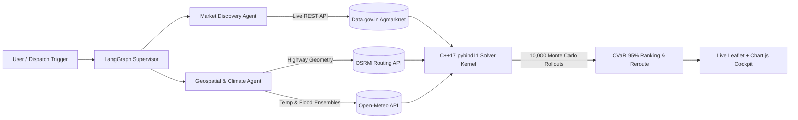

# ArbRoute-Swarm: Autonomous Stochastic Commodity Arbitrage & Climate-Resilient Logistics Engine

[](#)
[](#)
[](#)

**Author:** Chaitanya Gupta — B.Tech Computer Science & Engineering, IIT Palakkad  

---

## 1. Problem Statement
India loses **30–40% of perishable agricultural produce** post-harvest due to uncoordinated APMC mandi routing, highway thermal decay, and sudden climate disruptions (flash floods, monsoons, and severe heatwaves). Farmers and logistics operators currently rely on static navigation or raw spot prices—chasing high prices in distant markets without accounting for en-route spoilage or tail-risk weather delays.

## 2. Solution & Quantitative Formulation
**ArbRoute-Swarm** pairs a **LangGraph** multi-agent system with a low-latency **C++17 Monte Carlo graph solver** (`pybind11`) that computes **Conditional Value-at-Risk ($\text{CVaR}_{0.95}$)** across 10,000 simulated weather-traffic trajectories per route.

For a perishable shipment of initial mass $Q_0$ moving from origin $u$ to destination mandi $v$ over highway path $P$, the stochastic net profit $\Pi(P, \omega)$ under weather realization $\omega$ is:

$$\Pi(P, \omega) = Q_0 \cdot \exp\left(-\sum_{e \in P} \lambda_0 \cdot e^{\beta(T_{e,\omega} - 25)} \cdot \tau_{e,\omega}\right) \cdot \tilde{P}_{v}(\tau_{P,\omega}) - \sum_{e \in P} c_e \cdot d_e - \Phi_{\text{delay}}(\tau_{P,\omega})$$

Our C++17 solver selects the optimal route $P^*$ maximizing risk-adjusted expected margin:

$$P^* = \arg\max_{P} \left\{ \mathbb{E}[\Pi(P)] - \gamma \cdot \left( \mathbb{E}[\Pi(P)] - \text{CVaR}_{0.95}(\Pi(P)) \right) \right\}$$

## 3. System Architecture



## 4. Repository Structure
```text
arbroute-swarm/
├── index.html              # Live Zero-Mock Interactive Web Prototype (OSRM + Open-Meteo)
├── src/
│   ├── solver.cpp          # C++17 Monte Carlo & CVaR Engine (pybind11 bindings)
│   └── agent_graph.py      # LangGraph Stateful Multi-Agent Orchestrator
└── README.md               # Architecture, Quantitative Math & Setup Guide
```

## 5. Quick Start & Compilation Instructions

### A. Compile the C++17 `pybind11` Module
```bash
pip install pybind11 langgraph requests
c++ -O3 -Wall -shared -std=c++17 -fPIC $(python3 -m pybind11 --includes) src/solver.cpp -o src/arbroute_cpp$(python3-config --extension-suffix)
```

### B. Launch the Live Interactive Cockpit
Simply deploy the repository to **Vercel**, **GitHub Pages**, or **Netlify**, or run locally:
```bash
python3 -m http.server 8000
# Open http://localhost:8000 in your browser
```
